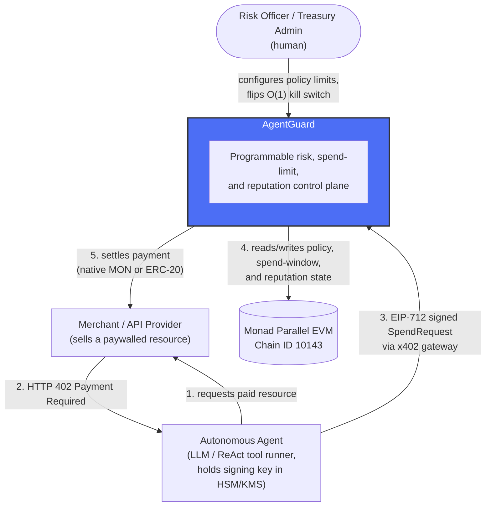
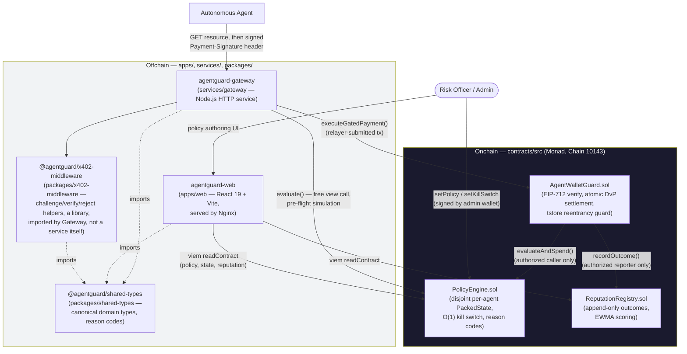
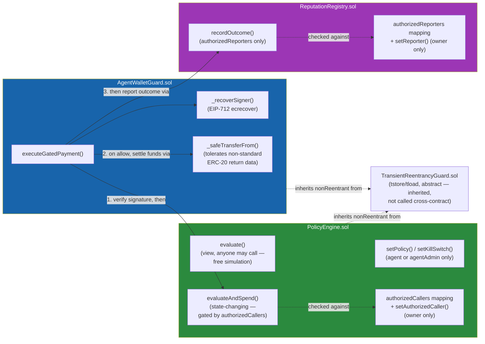
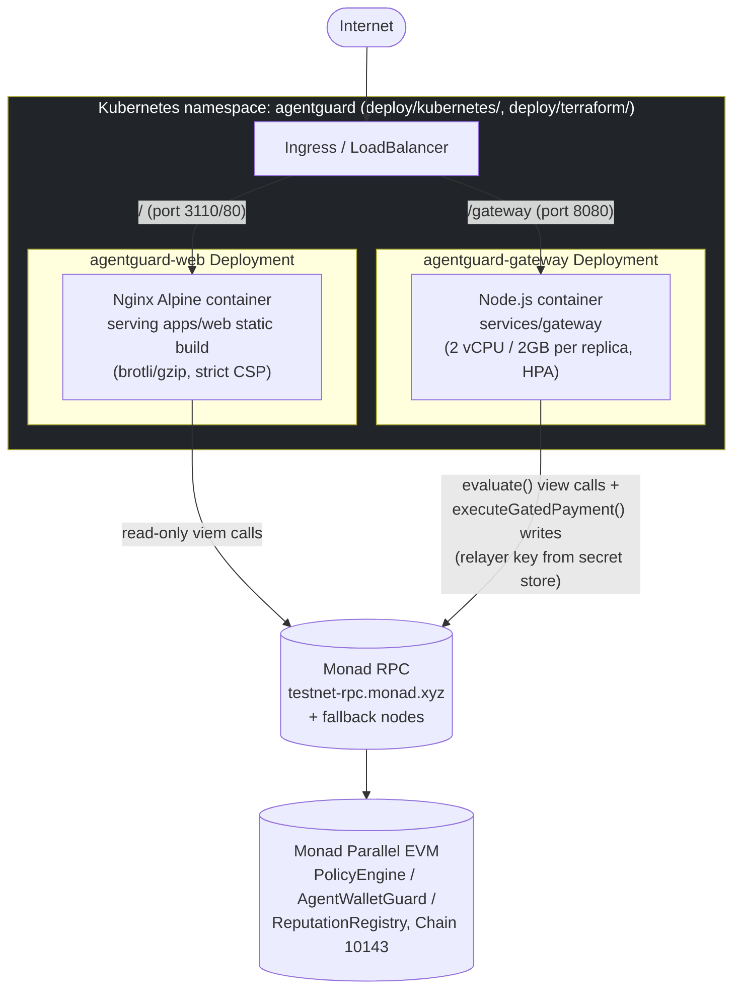

# AgentGuard Architecture Diagrams (C4)

Durable diagram artifacts, rendered from Mermaid so they stay in version control
as text and render natively on GitHub — replacing the ASCII-art boxes in
`README.md` / `docs/ARCHITECTURE.md` as the source of truth for structure.
Sequence/flow diagrams for individual operations already live in
`docs/SYSTEM_FLOWS.md`; this document covers the four levels the plan asked
for: system context, containers, components, and deployment.

## 1. System Context

Who and what AgentGuard talks to, and why.

## 2. Container Diagram

The four deployable units and where each piece of logic actually lives —
matches the real repository layout, not an idealized one.

## 3. Component Diagram — Onchain Core

Internal call graph of the three contracts plus the shared reentrancy guard,
including the authorization edges added in
[`docs/GAP_ANALYSIS.md`](GAP_ANALYSIS.md) finding 1.3 (`PolicyEngine` no longer
trusts any caller for `evaluateAndSpend`).

## 4. Deployment Diagram

Production topology as configured in `docker/docker-compose.yml` and
`deploy/kubernetes/*.yaml`.

---

**Local/single-host alternative:** `docker/docker-compose.yml` runs the same
two containers (`agentguard-web` on `:3110`, `agentguard-gateway` on `:8080`)
without Kubernetes, for local development and small deployments — see
`make docker-up`.
