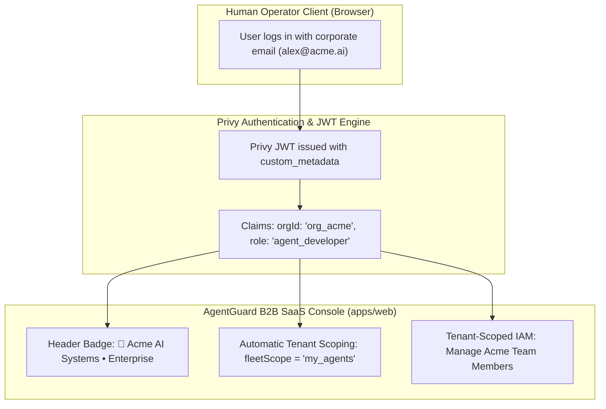

# AgentGuard: Enterprise B2B SaaS Multi-Tenancy & Agentic Developer Platform

## Executive Summary

AgentGuard is an institutional agentic risk, spend control, and execution guardrail platform engineered for the autonomous agent era on **Monad Parallel EVM (Chain ID 10143)**. 

This document defines the production **B2B SaaS Architecture** for AgentGuard, unifying:
1. **Single-Organization Tenant Isolation** with Privy Cloud Identity.
2. **Machine-to-Machine Service Accounts** for headless cloud bots.
3. **Comprehensive FinOps Pricing Engine** supporting Dual-Denomination (Tokens vs. Money) and enterprise contract structures (Flat Discounts, Volume Ladders, and CUD/PTU Capacity Quotas).
4. **Developer Integration Ecosystem** comprising a 1-Line Drop-in SDK Proxy, the `agentguard` CLI, and an official Model Context Protocol (MCP) Server.
5. **Scalable Workload Blueprint Catalog** replacing static UI layouts with dynamic, tenant-customizable templates.

---

## 1. Single-Organization B2B SaaS Multi-Tenancy

In enterprise SaaS (e.g. Datadog, Brex, Ramp, Vercel Enterprise), users do not manage multiple arbitrary workspaces via consumer switcher dropdowns. Each authenticated user belongs to **one dedicated organization** tied to their verified corporate email domain, SSO, or corporate invitation.



### Technical Specifications
* **Privy Custom Metadata Schema**:
  ```json
  {
    "sub": "did:privy:cmton65ao004l0cl11tgmwiah",
    "email": "alex@acme.ai",
    "custom_metadata": {
      "orgId": "org_acme_corp_8f2a",
      "orgName": "Acme AI Systems",
      "role": "agent_developer",
      "tier": "enterprise",
      "status": "ACTIVE"
    }
  }
  ```
* **Tenant-Scoped Authorization Proxy (`services/gateway`)**:
  - The master Privy App Secret remains strictly server-side within the Gateway.
  - Tenant Admins manage users via scoped endpoints: `POST /api/v1/orgs/:org_id/users`.
  - The Gateway strictly verifies that `caller.orgId == target_orgId` and caller possesses `super_admin` or `tenant_admin` authority before mutating Privy Cloud metadata. Any cross-tenant operation is rejected with HTTP 403 Forbidden.

---

## 2. Machine-to-Machine Service Accounts

Autonomous agents operate in headless cloud environments (Docker, Kubernetes, AWS Lambda) where human browser authentication via Privy or Web3 wallets is impossible.

### Service Account Architecture
1. **Machine Identity**: Each service account possesses an onchain Monad address (`0xAgent`) and an associated Bearer API Secret (`ag_live_sec_...`).
2. **Onchain Guardrail Binding**: The service account is directly bound to an assigned `BudgetPool` and `PackedPolicy` in Monad's `PolicyEngine.sol`.
3. **Execution Sandbox**: Service accounts have zero access to the human administrative web dashboard; their credentials can only be used to authenticate execution intents through the Gateway.

```bash
# Generated for autonomous bot deployments
AGENTGUARD_GATEWAY_URL="https://gateway.agentguard.io"
AGENTGUARD_API_KEY="ag_live_sec_9f82a4e98f2c0017"
AGENTGUARD_AGENT_ADDRESS="0x10143a4e98f2c000000000000000000000000017"
```

---

## 3. Comprehensive FinOps Pricing Engine

AgentGuard bridges the gap between foundation model billing (aggregate tokens, monthly invoices) and autonomous agent runtime execution (discrete, high-frequency calls).

### A. Dual Settlement Rails
* **BYOK Mode (Bring Your Own Key)**: Anthropic/OpenAI bills the customer's credit card at month-end. AgentGuard operates as a **pre-flight spending governor & circuit breaker**, cutting off rogue loops before tokens or dollars are incurred.
* **x402 Crypto-Native Mode**: Settles micro-payments per call or batch on Monad (MON / USDC) for autonomous bots with no human credit card.

### B. Dual-Denomination Guardrail Engine (Tokens + Dollars)
* **Token Quota (`tokenCap`)**: Tracks compute volume independently of currency (`usage.input_tokens + usage.output_tokens <= tokenCap`). 100% contract-invariant.
* **Financial Cap (`maxSpend`)**: Converts token usage into real fiat/MON liability, neutralizing the 5x input/output price gap and model price disparities (Haiku vs Sonnet vs Opus).
* **Non-Token API Coverage**: Tracks tool calls that charge per-operation (e.g. Firecrawl web scraping at $0.002/page; Serper search at $0.001/query).

### C. The 3 Enterprise Pricing Contract Models

```
┌────────────────────────────────────────────────────────────────────────────────────────┐
│                        3 Enterprise Pricing Execution Models                           │
├───────────────────────────────┬────────────────────────────────────────────────────────┤
│ Contract Model                │ Execution Architecture in AgentGuard Gateway           │
├───────────────────────────────┼────────────────────────────────────────────────────────┤
│ **1. Flat Custom Discount**   │ FinOps admin inputs contracted discount (e.g. 25% off) │
│    (Rate Card Override)       │ in Workspace Settings. Rate applied:                   │
│                               │ `UnitCost = ListPrice * (1.0 - discountPercent)`.      │
├───────────────────────────────┼────────────────────────────────────────────────────────┤
│ **2. Tiered Volume Ladders**  │ Gateway tracks `totalOrgTokensThisMonth`.              │
│    (Graduated Brackets)       │ Automatically steps down to Tier 2 (e.g. -15%) at      │
│                               │ 100M tokens and Tier 3 (e.g. -30%) at 500M tokens.     │
├───────────────────────────────┼────────────────────────────────────────────────────────┤
│ **3. Committed-Use / PTUs**   │ Marginal token cost inside commit is $0 (sunk).        │
│    (Capacity Quota Mode)      │ AgentGuard acts as a **Capacity Quota Allocator** and  │
│                               │ **Overage Firewall** against expensive on-demand spill.│
└───────────────────────────────┴────────────────────────────────────────────────────────┘
```

### D. Native Provider Discount Auto-Detection
* **Anthropic Batch API**: Auto-detects `/v1/messages/batches` and applies a flat $0.50\times$ discount factor.
* **Prompt Caching**: Precisely credits Anthropic's 90% discount on `cache_read_input_tokens` and computes 1.25x on `cache_creation_input_tokens`.

---

## 4. Developer Ecosystem (CLI, SDK Proxy & MCP Server)

### A. 1-Line Drop-In SDK Proxy
Developers configure standard OpenAI or Anthropic SDKs by modifying only the `base_url` and inserting their AgentGuard Service Account Key:

```python
from anthropic import Anthropic

client = Anthropic(
    base_url="https://gateway.agentguard.io/v1/anthropic",
    api_key=os.environ["AGENTGUARD_API_KEY"],
)

response = client.messages.create(
    model="claude-3-7-sonnet",
    max_tokens=1024,
    messages=[{"role": "user", "content": "Execute scheduled market analysis"}],
)
```

### B. AgentGuard CLI (`packages/cli` -> `agentguard`)
```bash
# Terminal authentication
agentguard login

# Fleet inspection & real-time telemetry
agentguard fleet status --org acme_ai

# Register new agent with 5M token cap
agentguard agents register --name "analyst-bot" --tokens 5000000 --window 7d

# Instant O(1) emergency freeze
agentguard agents freeze 0x10143a4e98f2c000000000000000000000000017
```

### C. Model Context Protocol (MCP) Server (`@agentguard/mcp-server`)
Standardized server implementing Anthropic's MCP specification over stdio and SSE transport, giving Claude Desktop, Cursor, and autonomous agent loops native self-awareness:
* `agentguard_check_budget(agentAddress)`: Inspects remaining token and financial budget before high-compute tasks.
* `agentguard_inspect_limits(agentAddress)`: Returns velocity rate limits, window reset times, and active freeze status.
* `agentguard_request_spend_elevation(amount, justification)`: Submits signed budget elevation requests to human supervisors.

---

## 5. Scalable Workload Template Catalog

Replaces the legacy static 4-box layout with a responsive, non-truncating B2B SaaS catalog:
* **Rich Metadata**: Name, Workload Category (Inference, Scraping, Distributed Training, DeFi Arbitrage, Threat Intelligence), Token Quotas, Dollar Caps, Velocity, Whitelisting, and Operational Descriptions.
* **Admin Custom Templates**: Organization admins can create custom workload templates tailored to internal departmental standards (`+ Custom Template`).
* **Tenant Isolation**: Custom templates are stored in the organization's workspace, private from other tenants.

---

## 6. Alignment with `docs/ROADMAP.md` & Sponsor Bounties

| Component | Hackathon Milestone | Target Bounty | Key Verification Artifacts |
|---|---|---|---|
| **Privy Multi-Tenancy** | Phase 2 (Sep 21–28) | **Privy! (\$5,000 USD)** | `ADR-0009`, `RbacContext.tsx`, `services/gateway/src/privy.rs`. |
| **FinOps Pricing Engine** | Phase 2 & 3 (Sep 21–Oct 6) | **Monad Community (\$5,000 USD)** | `ADR-0010`, `PolicyEngine.sol`, Two-Phase Metering Pipeline. |
| **CLI & MCP Server** | Phase 3 (Sep 29–Oct 6) | **Design & Craft (20% Rubric)** | `ADR-0011`, `@agentguard/mcp-server`, 1-Line Drop-in SDK Proxy. |
| **Qwen 3.8 Max Copilot** | Phase 2 & 3 (Sep 21–Oct 6) | **Alibaba Qwen (\$5,000 USD)** | `ADR-0008`, In-Browser Natural Language Policy Generator. |
