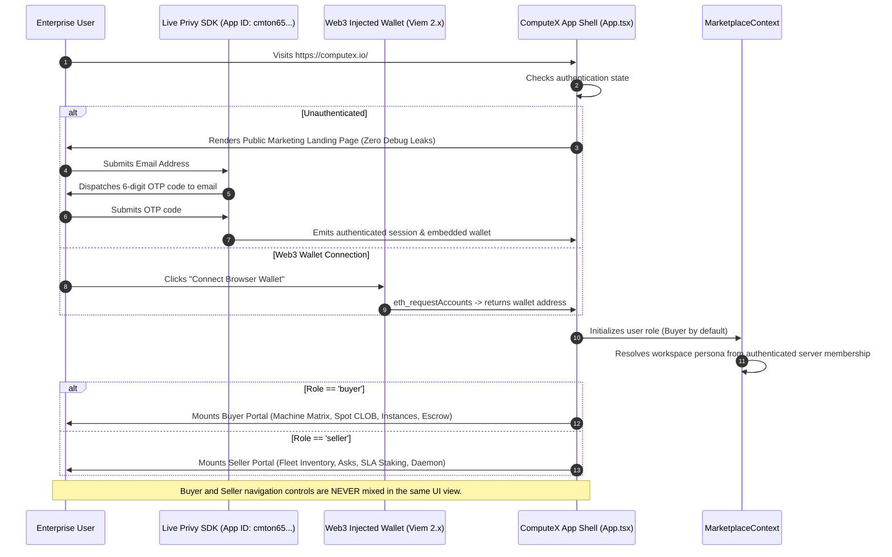
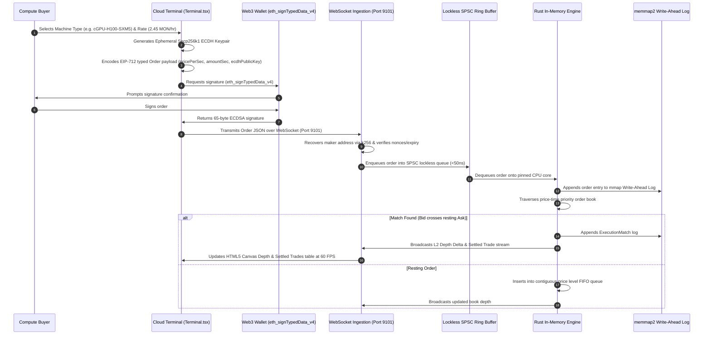
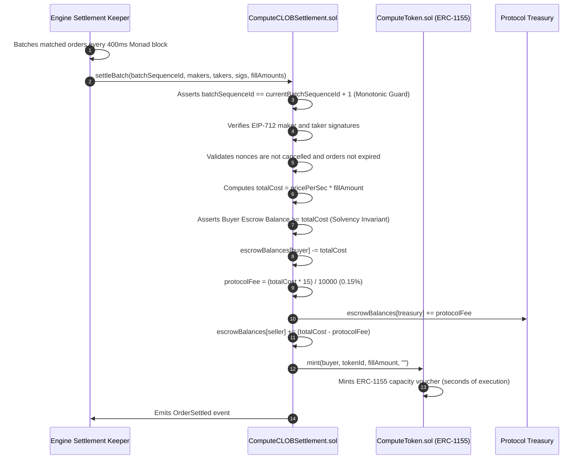
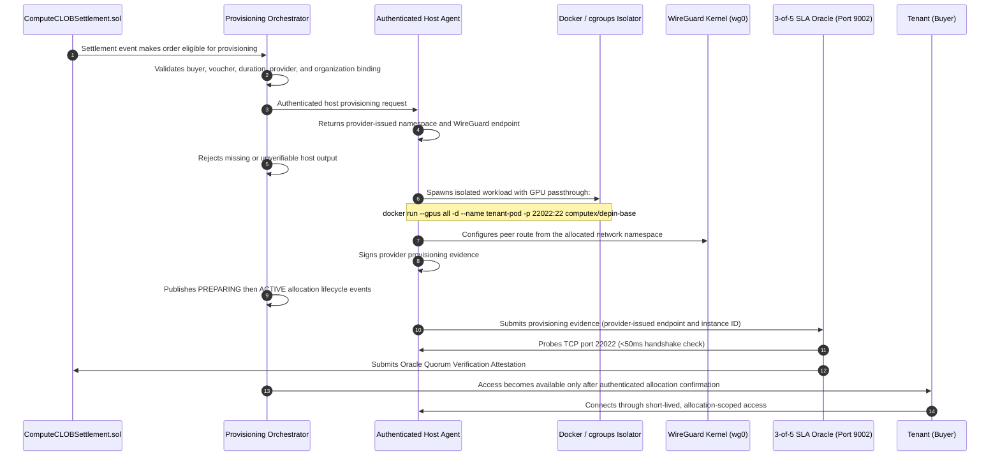
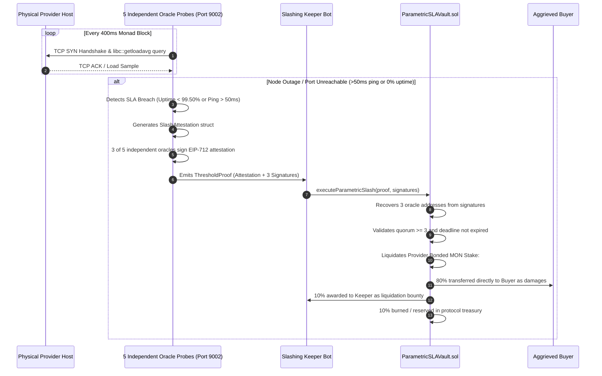
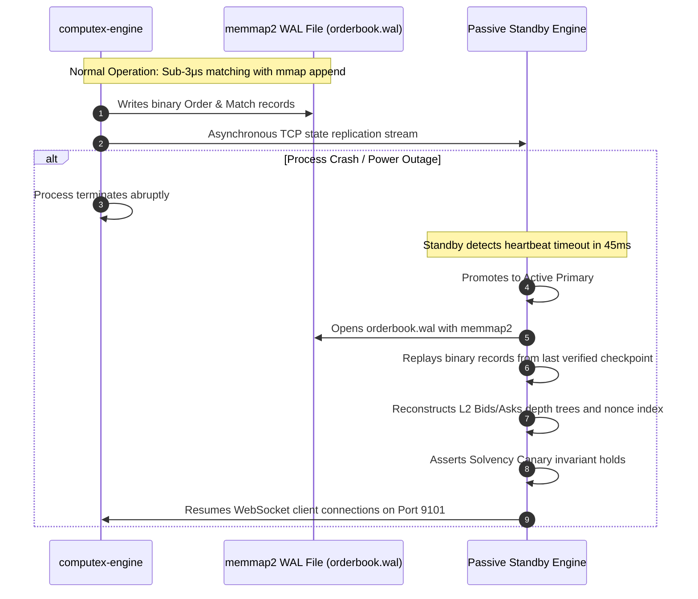

# ComputeX End-to-End System Flows & State Machines

This document provides exhaustive sequence diagrams, state machines, and technical walkthroughs for all seven primary operational workflows in ComputeX.

---

## Table of Contents
1. [Flow 1: Authentication & Role Exclusivity](#flow-1-authentication--role-exclusivity)
2. [Flow 2: Spot Order Placement & Microsecond Matching](#flow-2-spot-order-placement--microsecond-matching)
3. [Flow 3: Atomic Monad DvP Settlement & Voucher Minting](#flow-3-atomic-monad-dvp-settlement--voucher-minting)
4. [Flow 4: Physical Node Provisioning & Credential Handoff](#flow-4-physical-node-provisioning--credential-handoff)
5. [Flow 5: 3-of-5 SLA Oracle Probing & Parametric Slashing](#flow-5-3-of-5-sla-oracle-probing--parametric-slashing)
6. [Flow 6: Recurring Payments & Continuous Streaming Billing](#flow-6-recurring-payments--continuous-streaming-billing)
7. [Flow 7: Disaster Recovery & Crash Consistency](#flow-7-disaster-recovery--crash-consistency)

---

## Flow 1: Authentication & Role Exclusivity

ComputeX separates unauthenticated marketing visitors from authenticated enterprise operators, and strictly isolates the **Compute Buyer Console** from the **Node Operator / Seller Console**.

---

## Flow 2: Spot Order Placement & Microsecond Matching

---

## Flow 3: Atomic Monad DvP Settlement & Voucher Minting

---

## Flow 4: Physical Node Provisioning & Credential Handoff

---

## Flow 5: 3-of-5 SLA Oracle Probing & Parametric Slashing

---

## Flow 6: Recurring Payments & Continuous Streaming Billing

```mermaid
stateDiagram-v2
    [*] --> EscrowFunded: Buyer deposits MON into Escrow
    EscrowFunded --> StreamActive: Buyer initiates "⚡ RECURRING STREAM" Lease
    
    state StreamActive {
        [*] --> StreamingExecution
        StreamingExecution --> StreamingExecution: BurnRate (MON/sec) debited lazily
        StreamingExecution --> MarginWarning: Escrow Runway < 3 Hours
        MarginWarning --> StreamingExecution: Buyer Tops Up Escrow
    }
    
    MarginWarning --> GracePeriod: Escrow Balance Reaches 0.0000 MON
    
    state GracePeriod {
        [*] --> FrozenWorkload: Daemon pauses container (SIGSTOP)
        FrozenWorkload --> StreamActive: Top-up deposited within 30 min
        FrozenWorkload --> Terminated: 30-min window expires without top-up
    }
    
    StreamActive --> UserTerminated: Tenant clicks "STOP LEASE"
    UserTerminated --> [*]: Unused Escrow Refunded; Container Deprovisioned
    Terminated --> [*]: Container Destroyed; Storage Sanitized
```

---

## Flow 7: Disaster Recovery & Crash Consistency

