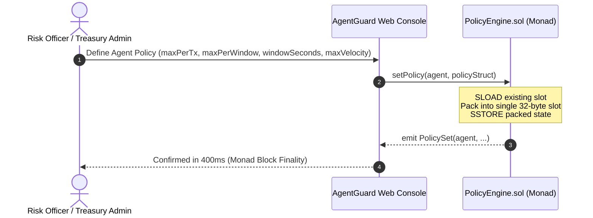
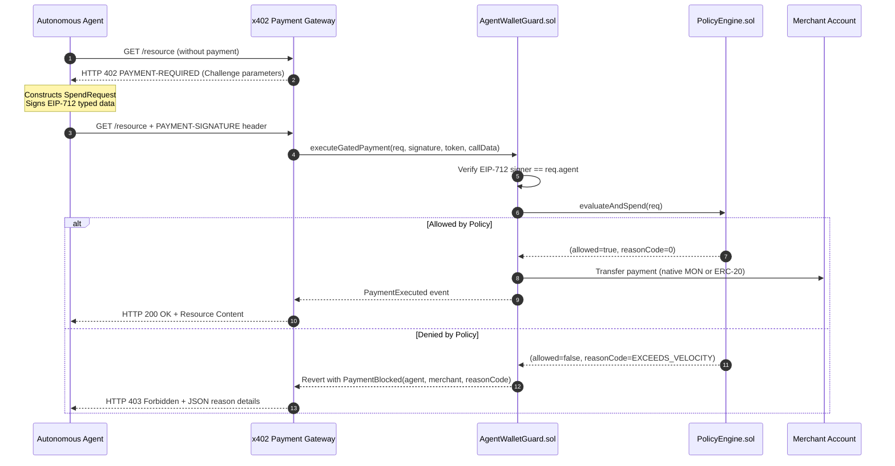
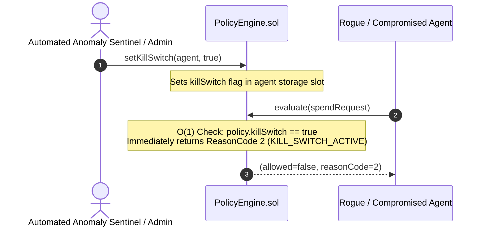

# AgentGuard End-to-End System Flows & State Machines

This document provides sequence diagrams and technical walkthroughs for the core operational workflows in AgentGuard.

---

## 1. Flow 1: Policy Configuration & Fleet Provisioning

---

## 2. Flow 2: Gated Payment with x402 / AP2 Negotiation

---

## 3. Flow 3: O(1) Instant Kill Switch Trigger

